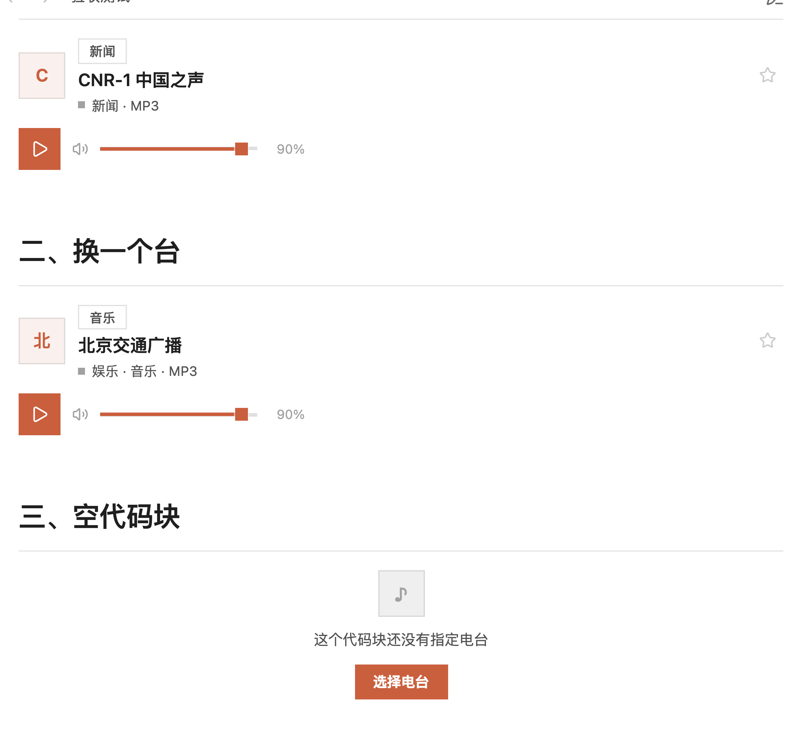
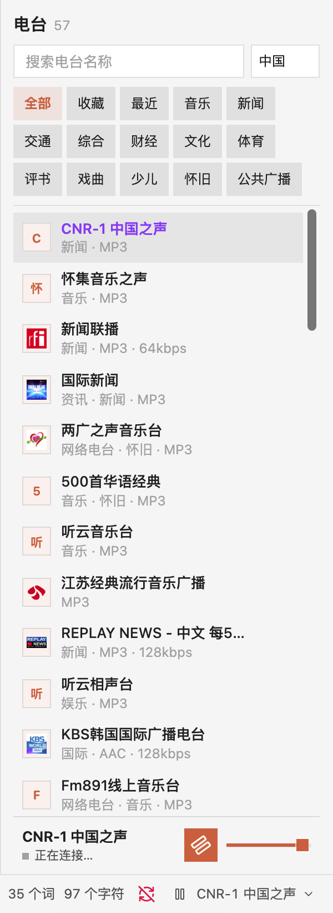
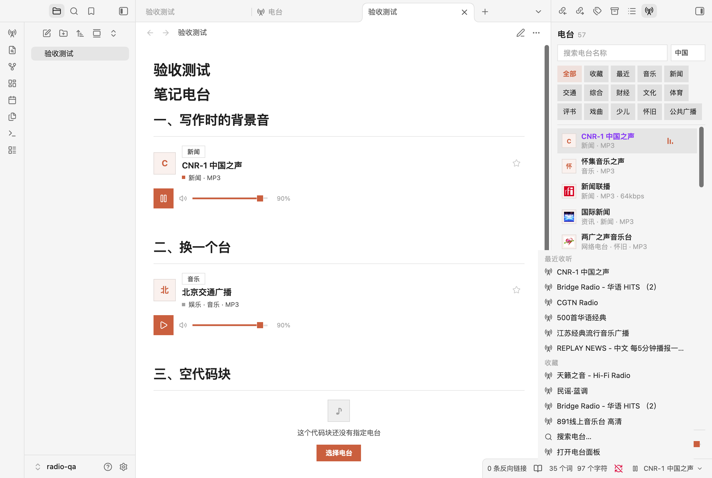

# Berry Radio

> Play live radio inside Obsidian — a player in your notes, a panel in the sidebar, and a mini player in the status bar.

Berry Radio turns the [radio-browser.info](https://www.radio-browser.info/) directory into three real players that share one playback instance. Start a station from a note, switch it from the status bar, and never leave the note you are writing in.

| Where | What it is |
|---|---|
| In a note | A player card: cover, category, station name, and a single-row control (play/stop + volume) |
| Sidebar or tab | A full panel: search, category filter, station list, and a one-row player at the bottom |
| Status bar | A permanent mini player: play/stop, current station, and a menu to switch stations |

## Features

- **Three shared players.** One playback instance, one state. Starting a station anywhere updates the other two immediately.
- **Player card in notes.** Write a `radio` code block, the station name goes inside, and you get a player that stays in your prose.
- **Category filter.** Music, news, traffic, talk, sports, culture and more, mapped from the directory's raw tags into readable Chinese categories.
- **Status bar control.** It stays visible whether or not something is playing, and switching stations happens in a menu overlay, so the current note is never navigated away from.
- **Reliable stream selection.** The same station often has several mirrors. Candidates are ordered by playability (verified first, direct MP3/AAC before HLS, HTTPS before HTTP, then popularity), and up to three sources are tried in turn.
- **Honest, minimal interface.** Square shapes only, one brand color, hairline separators, and no decorative glow.

## Screenshots

Player card in a note:



Sidebar panel with the one-row player at the bottom:



Status bar menu for switching stations:



## Install

### From the community directory

Search for **Berry Radio** in **Settings → Community plugins → Browse**. Obsidian then keeps it up to date from the GitHub releases.

### Manual

Download `main.js`, `manifest.json` and `styles.css` from the [latest release](https://github.com/berry51/berry-radio/releases/latest) and put them in:

```
<your vault>/.obsidian/plugins/berry-radio/
```

The folder name must match the plugin id `berry-radio`. Then enable it under **Settings → Community plugins**.

### With BRAT

Add `berry51/berry-radio` to BRAT's beta list if you prefer installing from source.

## Network use and privacy

This plugin needs the network, and it is the only thing it uses it for:

- **Station directory:** [radio-browser.info](https://www.radio-browser.info/), a public, key-free API. The plugin queries it for station names, categories and stream URLs, and requests fall back across its mirrors (`de1`, `nl1`, `fi1`, `at1`). Responses are cached in memory for five minutes.
- **Audio streams:** the plugin plays the stream URL published by the directory. Audio is streamed directly from the broadcaster's server to you; it is never re-hosted, re-encoded, recorded or redistributed by the plugin.
- **Artwork:** station logos are loaded from the `favicon` URL published in the directory, when that URL is HTTPS.

The plugin collects no telemetry, has no accounts, requires no payment, and stores nothing outside your vault. Favorites and recently played stations live in the plugin's own data file (`.obsidian/plugins/berry-radio/data.json`). Plain HTTP streams are filtered out by default because Obsidian blocks mixed content; you can allow them in the settings.

## Build from source

```bash
npm install
npm run build      # type-check + production bundle into main.js
npm test           # unit and DOM tests
```

`main.js` is a deterministic production bundle produced by esbuild, with `hls.js` bundled in (Apache-2.0). The workflow in `.github/workflows/build.yml` rebuilds the bundle and fails if it differs from the committed one, so the release asset always matches the source.

## 中文说明

在 Obsidian 里听电台。三个位置各有一个真正的播放器：

| 位置 | 形态 |
|---|---|
| 笔记里 | 内嵌播放器：顶部发丝线、左对齐融入正文，封面 + 分类标 + 台名 + **单行控制**（播放/停止 + 音量） |
| 右侧栏 / 独立页面 | 完整面板：搜索 / 分类 / 列表 + 底部播放器（封面 · 台名 · 播放/停止 · 音量，同一行） |
| 状态栏 | 常驻迷你播放器：播放/停止 + 当前台名 + 切台箭头（下拉菜单切台，不离开笔记） |

点左侧功能区（ribbon）的电台图标 = 在主区域打开**独立页面**；命令面板另有「打开电台面板（右侧栏）」。

三处共享同一个播放实例与同一份状态，任一入口操作，其余两处立即同步。设置里可逐项开关，也可只留一种。

### 安装

```bash
npm install
npm run build

mkdir -p "<你的库>/.obsidian/plugins/berry-radio"
cp main.js manifest.json styles.css "<你的库>/.obsidian/plugins/berry-radio/"
```

在 **设置 → 第三方插件** 启用。插件 id 为 `berry-radio`，文件夹名必须一致。

开发：`npm run dev`（esbuild watch）、`npm test`、`npm run build`。

### 用法

#### 笔记里的播放器

````markdown
```radio
北京交通广播
```
````

代码块正文是查询词，渲染成一张播放器卡片。留空则使用设置里的「默认电台」；两者都没有时卡片显示「选择电台」按钮。

> 卡片上的播放键只控制播放，不会改动你的笔记。

**控制区只有一行**：播放/停止 + 音量并排居中。电台是直播流，没有「上一曲 / 下一曲」——播放中按下即停止并断开连接（界面用暂停图标表达，行为是真停止：暂停会让缓冲继续跑，恢复时听到的是几分钟前的内容）。切台在列表里点选。

**卡片样式**（设置 → Berry Radio → 卡片排版）：

- **紧凑式 · 细线内嵌**（默认）：无卡片盒，顶部一条发丝线，左对齐融入笔记流，适合密集笔记
- **唱片式**：竖向大卡，方形大封面 + 居中播放键 + 独立音量行

视觉规则（完整见 [DESIGN.md](DESIGN.md)）：

- **全直角**：所有 `border-radius: 0`，封面是正方形、播放键是正方形、分类标是直角矩形，没有圆形和药丸。
- **单一品牌色** `#d86d43`（暖赤陶）：只出现在实心播放键、播放状态点、选中分类、焦点环和空态按钮；不跟随主题、不按电台派生色相。
- 表面与文字仍用 Obsidian 变量，浅色/深色主题自动适配。

封面优先用电台自己的台标（favicon）；没有时显示**品牌淡橙底 + 橙字**的方形色块（全场同一个色，不是每台一色）。

#### 右侧栏 / 独立页面

点左侧功能区（ribbon）的电台图标会在主区域打开**独立页面**；要开在右侧栏，命令面板执行 **打开电台面板（右侧栏）**。

- 搜索框按名称检索（服务端搜索，250ms 防抖）
- 分类条：全部 / 收藏 / 最近 / 音乐 / 新闻 / 交通 / 综合 / 财经 / 文化 / 体育 / 评书 / 戏曲 / 少儿 / 怀旧 / 公共广播
- 点行播放，点星收藏；播放中的行显示跳动的音量条
- 底部播放器：与列表**只用一条顶部发丝线分隔**（无卡片盒、无背景色块），整条压成一行——封面 · 台名/状态 · 播放/停止 · 音量；窄侧栏自动隐藏封面与音量图标/百分比，把宽度让给台名
- 播放器紧贴视图底部：Obsidian 默认给视图留的 32px 底部空白会按状态栏实际高度动态调整，状态栏隐藏时留 0

「下一台 / 上一台」只在**当前列表**内切换，界面上没有按钮（电台是直播流，不需要曲目式方向键）。

#### 状态栏

设置里开启后**常驻**在右下角（不再只在播放时出现，停止后也不会消失）：

- **播放/停止键**：播放中按下即停止；停止后再按会重播刚才那台；什么都没有时打开选台弹窗
- **台名 / 箭头**：点开下拉菜单切台——「最近收听」「收藏」「搜索电台…」「打开电台面板」
- 菜单与选台弹窗都是**覆盖层**，当前笔记不会被切走——这正是状态栏存在的意义：不离开当前笔记就能控制电台
- 没有电台在播时台名显示「选择电台」，整条仍然可点

> 菜单是插件自己画的浮层（直角、发丝线、跟随主题），没有用 Obsidian 的系统原生菜单——原生菜单是圆角的系统样式，和插件的全直角设计语言对不上。

#### 命令

| 命令 | 说明 |
|---|---|
| 打开电台面板（右侧栏） | 在右栏打开面板 |
| 打开电台页面 | 在主区域以标签页打开 |
| 插入电台到当前笔记 | 搜索并插入 `radio` 代码块 |
| 播放或停止 | 全局快捷键（直播流：播放中按下即停止并断开） |
| 停止播放 | 停止并清空 |
| 上一台 / 下一台 | 在当前列表内切换（只保留命令入口，界面上没有这两个按钮） |
| 收藏或取消收藏当前电台 | 切换收藏 |

### 取流策略

同一个电台在公共目录里往往有多个源。**不能按名称相似度挑**——「中国之声」有 6 个候选，排第一的是可用 MP3，但恰好同名的第 4 个指向不可达的 HLS。

现在的规则：

1. 候选只按**可播性**排序：探测通过优先 → 直连音频（MP3/AAC）优先于 HLS → https 优先 → 热度。
2. 播放时按顺序最多尝试 3 个源，前一个失败自动换下一个，界面显示「正在尝试第 2 个源…」。
3. 三个都失败才报错。

### 数据来源与联网说明

电台目录来自 [radio-browser.info](https://www.radio-browser.info/) 公开 API，无需密钥。中国区 `hidebroken=true` 约 2170 个频道，按点击热度排序。

用 Obsidian 的 `requestUrl` 拉取（绕过渲染进程跨域限制），对 `de1 / nl1 / fi1 / at1` 四个镜像轮询兜底，会话内缓存 5 分钟。收藏与最近收听保存在插件数据中，不联网。

插件不收集任何遥测、没有账号、不付费、不在 vault 之外写文件。音频流直接从广播方服务器送到本地，不录音、不转存、不分发。

### 已知限制

1. **http 流默认被过滤。** 中国区约 33%（723/2170）只提供不加密的 http 流，Electron 的 `app://` 属安全上下文，混合媒体会被拦。设置里可放开，失败属预期。
2. **失效源无法完全避免。** 公共目录由用户提交，站点关停、换 CDN、加防盗链都会失效。已有三源自动回退，但仍可能全部失败。
3. **个别 CDN 对 `app://` 源直接拒绝**（如 `ngcdn001.cnr.cn`），该台不可用。MP3/AAC 直连流不受影响。
4. **移动端未验证。** `isDesktopOnly` 为 `false`，代码不含 Node/Electron 依赖，但无真机证据。
5. **不录音、不转存、不分发。** 播放器只指向公开流。

### 验证记录（2026-10-21，0.9.0）

**设计锚**：见 [DESIGN.md](DESIGN.md)。

**单元与 DOM 测试**：`npm test` → 5 个文件 48 个用例全通过。

**真实宿主**：Obsidian 1.12.4 / 1.14.4（macOS），独立 QA 库，CDP 驱动真机点击 + 截图：

| 验收项 | 结果 |
|---|---|
| 插件加载 | 0.9.0，卡片排版 compact（细线内嵌） |
| 笔记内嵌播放器 | 3 处：两张 ready（40px 方形封面 + 36px 方形播放键 + 分类标 + 音量），一张空态带实心「选择电台」 |
| 卡片播放 | 点播放键 → 「CNR-1 中国之声」`playing`，图标切为暂停，状态点转强调色 |
| 卡片停止 | 再点播放键 → `status: idle`、`station: null`（真停止，不是暂停） |
| 侧栏播放器 | 单行：封面 · 台名/状态 · 播放/停止 · 音量；与列表仅一条发丝线分隔 |
| 渲染进程异常 | 无 |

**控制区断言**（`scripts/verify-transport.cjs`，真机计算样式 + 几何测量）:

| 断言 | 结果 |
|---|---|
| 控制区按钮数 | 笔记卡片 **1** 个、侧栏 **1** 个（`skipButtons: 0`）✓ |
| 播放键与音量同一行 | `sameRow: true`，垂直居中偏差 **0px** ✓ |
| 控制区是否单行 | `transportH === playH`（36/36、34/34）✓ |
| 卡片总高 | **144px**（带独立音量行时为 172px）✓ |
| 播放键图标 | 播放中为 `pause`（按下即停止），不是 `square` ✓ |

**侧栏播放器断言**（`scripts/verify-nowbar.cjs`，300px 窄侧栏，空态与播放态各测一次）:

| 断言 | 结果 |
|---|---|
| 行数 | **1** 行（`rows: 1`）✓ |
| 滑块与轨道中心 | 偏差 **0.00px** ✓ |
| 滑块与行中心 | 偏差 **0.00px** ✓ |
| 播放键与行中心 | 偏差 **0.00px** ✓ |
| 边框 | `1px / 0px / 0px / 0px`（只有顶部发丝线）✓ |
| 背景 | `rgba(0, 0, 0, 0)`（无背景色块）✓ |
| 整条高度 | **52.4px** ✓ |

**形状与配色断言**（`scripts/verify-shape.cjs`，真机计算样式，遍历作用域内全部元素）：

| 断言 | 结果 |
|---|---|
| `border-radius` 违规数 | **0**（扫描 617 个元素，全部 `0px`）✓ |
| 径向光晕 `radial-gradient` | 0 处 ✓ |
| 纯黑投影 `rgb(0,0,0)` | 0 处 ✓ |
| 强调色是否唯一 | 去重后仅 `#d86d43` ✓ |
| 播放键 | 背景 `rgb(216,109,67)`、radius `0px` ✓ |
| 选中分类 | accent-soft 13% 底 + accent 字、radius `0px` ✓ |

> 踩坑记录 ①：Obsidian 主题会给 `input[type=range]` 与输入框加 4px / 8px 圆角，`.br-volume__range` 这种纯类名选择器特异性不够，形状锁会被击穿。必须写成 `.br-volume input.br-volume__range`。
>
> 踩坑记录 ②：原生滑块的 `::-webkit-slider-thumb` 靠 `margin-top: -4px` 抵消 3px 轨道高度来居中，一旦主题改写轨道高度，滑块就整体偏上约 4px，且伪元素样式无法从外部读取/修正。0.7.0 起轨道、填充、滑块全部自绘，原生 input 透明叠层只负责交互，居中由 `top: 50% + translateY(-50%)` 保证。

**控件外壳断言**（`scripts/verify-player-chrome.cjs`，300px 侧栏 + ribbon）：

| 断言 | 结果 |
|---|---|
| 播放中图标 | 侧栏 / 笔记卡片 / 状态栏均为 `pause` ✓ |
| 点 ribbon 图标 | 在主区域打开**独立页面**（`inRoot: 1`、`inSidebar: 0`）✓ |
| 状态栏显示时 | 视图底部留位 = 状态栏实际高度 `25px` ✓ |
| 状态栏隐藏时 | 视图底部留位 `0px`，播放器紧贴底边（`gapBelowNow: 0`）✓ |
| 状态栏隐藏后 | `status-bar-item` 宿主一并隐藏，不留空的点击区 ✓ |

> 踩坑记录 ③：Obsidian 的 `.status-bar` 是 `position: fixed`，并给
> `.workspace-leaf-content .view-content` 设了 `padding-bottom: max(safe-area-inset-bottom, 32px)`  给它留位。
> 想抹掉这段空白，选择器必须带上 `.workspace-leaf-content .view-content`（0,2,0）才能压过 `.br-view`（0,1,0），
> 并且不能写死 0——状态栏显示时会把播放器盖住。正确做法是按状态栏实测高度动态写 `--br-status-inset`。

**状态栏断言**（`scripts/verify-statusbar.cjs`，真实宿主 + 真实点击）：

| 断言 | 结果 |
|---|---|
| 空闲时常驻 | 可见、宿主可见、文案「选择电台」、2 个按钮（播放 + 切台）✓ |
| 播放中图标 | `lucide-pause` ✓ |
| 停止后 | 条目与宿主**都还在**，台名保留，`status: idle` / `station: null` ✓ |
| 停止后再按播放键 | 重新播放刚才那台（`status: playing`）✓ |
| 点台名 | 弹出切台菜单，含「最近收听」「收藏」两个分组 + 「搜索电台…」「打开电台面板」✓ |
| 菜单里能直接切台 | 列出 10 个最近收听 + 收藏电台 ✓ |
| **当前笔记不被切走** | 打开菜单前后 activeLeaf 都是 `验收测试.md` ✓ |

**未覆盖**：移动端真机、社区目录审核、公开发布。

## 许可

MIT。hls.js 以 Apache-2.0 打包进 `main.js`。
